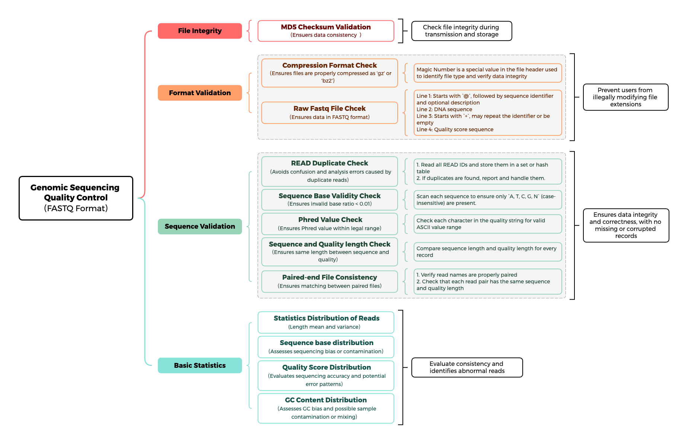

FastqCheck
=========================
An efficient tool for FASTQ sequencing data format validation and quality statistics.


__PROGRAM: fastqcheck__<br>
__VERSION: 2.0.7__<br>
__PLATFORM: Linux / macOS__<br>
__ARCHITECTURE: x86_64 / arm64__<br>
__COMPILER: gcc (C99)__<br>
__AUTHOR: xiaolong zhang__<br>
__EMAIL: xiaolongzhang2015@163.com__<br>
__DATE:   2022-07-25__<br>
__UPDATE: 2026-11-19__<br>
__DEPENDENCE__<br>
* __CMake (>= 3.16) and gcc/clang__<br>
* __zlib-ng__ (bundled source tree, no system zlib required)<br>
* __bzlib__ (bundled source tree, no system bzip2 required)<br>
* __pthread__<br>


# 1. Description

* FastqCheck is a fast and reliable tool for validating the format of raw genomic FASTQ sequencing data and generating quality statistics.<br>
* It accepts plain (`.fq` / `.fastq`), gzip-compressed (`.fq.gz` / `.fastq.gz`) and bzip2-compressed (`.fq.bz2` / `.fastq.bz2`) FASTQ files, and supports **single-end** (1 file), **paired-end** (2 files) and **single-cell** (4 files) data of one sample in a single run.
* It performs **format checking** — phred quality values (33/64), pair markers (`'1'` / `'2'`), read name ordering between files, sequence/quality length consistency, invalid bases, and truncated file detection.
* It performs **quality statistics** — base composition (A/C/G/T/N), GC content, read length distribution, per-file statistics and quality score distribution.
* It checks **duplicate read names** with a Bloom filter (false positive rate as low as `1e-9`), so the memory usage stays tiny even for hundreds of millions of reads.
* Since v2.0.0, the check flow is redesigned as a **multithreading pipeline** (reader thread + reader threadpool + checker threadpool + duplicate-check thread, see [Architecture](#6-architecture)), which significantly speeds up the checking of large-scale data on multi-core machines.
* It writes the statistics as an **SRA-compatible XML** file (`spot_count` / `base_count` / `GC-Content` / `QualityCount` ...), which can be directly used for NCBI/CRA SRA submission, together with a text error report file.


# 2. Building


## 2.1 Dependencies

FastqCheck is built with **CMake** and a C99 compiler (gcc/clang). Both third-party
libraries are managed uniformly in the `external/` directory. The libraries are:

* **zlib-ng** — bundled as a local source tree (`external/zlibng/`) and compiled as a static library
  in the zlib-compatible mode (`ZLIB_COMPAT`), which exports the classic zlib API
  (`gzopen` / `gzread` / `gzwrite` / `gzclose` ...) with an unchanged `zlib.h`, so no system
  zlib is required
* **bzlib** — bundled as a local source tree (`external/bzip2/`) and compiled as a static library
  (the `bz2_static` target), which exports the classic bzlib API (`BZ2_bzReadOpen` /
  `BZ2_bzWriteOpen` ...), so no system bzip2 is required
* **pthread** — required for multi-threading support

## 2.2 Compilation

```bash
cd FastqCheck
cmake -S . -B build       # configure (default: Release)
cmake --build build -j    # build fastqcheck
```

The compiled binary `fastqcheck` will be generated in `build/`.

## 2.3 Build Options

CMake provides a `CMAKE_BUILD_TYPE` switch to select between release and debug builds:

| `CMAKE_BUILD_TYPE` | Default | Description                                                    |
|--------------------|---------|----------------------------------------------------------------|
| `Release`          | yes     | compile with `-O3` optimizations, for production use           |
| `Debug`            | no      | compile with `-g -O0`, for debugging                           |

To build the debug version (e.g. in a separate `build-debug/` directory):

```bash
cmake -S . -B build-debug -DCMAKE_BUILD_TYPE=Debug
cmake --build build-debug -j
```

Clean build artifacts:

```bash
rm -rf build build-debug
# or
cmake --build build --target clean
```


# 3. Usage

```
Usage: fastqcheck -i <fastq_list.txt> -o <output_file.xml> -e <error_file.err> -x <max_reads> -P <phred_value>
Note: you MUST RUN fastq_type for file type checking before fastqcheck!
```

**Prerequisites:** before running fastqcheck, run `fastq_type` on the same file list. fastq_type verifies the file format (gzip/bzip2 magic code), detects truncated or renamed files, and estimates the values of `-x|--max_reads` and `-P|--phred_value` for fastqcheck.


## 3.1 Options Summary

##### Required Options

| Option             | Argument | Description                                                                 |
|--------------------|----------|-----------------------------------------------------------------------------|
| `-i`, `--in_file`  | FILE     | **\[Required]** fastq file list, one sample path per line [.txt]            |
| `-o`, `--out_file` | FILE     | **\[Required]** output xml file of the given fastq files after checking [.xml] |
| `-e`, `--error_file` | FILE   | **\[Required]** warning or error message about the given fastq files [.err] |
| `-x`, `--max_reads` | INT     | **\[Required]** the estimated maximum number of reads (estimated by fastq_type) [unit: million] |
| `-P`, `--phred_value` | INT   | **\[Required]** the phred value of the fastq file (estimated by fastq_type, 33 or 64) |

##### Optional Options

| Option            | Argument | Description                                                                  |
|-------------------|----------|------------------------------------------------------------------------------|
| `-r`, `--ratio`   | INT      | the estimated compression ratio of the fastq file [default: 10]              |
| `-m`, `--max_length` | INT    | the length limit (MiB) for each FASTQ line [default: 50 MiB]     |
| `-t`, `--thread`  | INT      | number of thread used when processing the fastq file [default: 1]            |
| `-p`, `--pair_check` | INT    | check whether all reads have the same pair marker (1->check; 0->ignore) [default: 1] |


## 3.2 Option Details

#### \[-h \| --help]

Print the help information and exit.

---

#### \[-i \| --in_file]

A text file (without header) containing the full paths of the FASTQ files to be checked, one file per line. Both plain FASTQ (`.fq` / `.fastq`) and compressed FASTQ (`.fq.gz` / `.fastq.gz` / `.fq.bz2` / `.fastq.bz2`) are supported.

**Example:**
```
/home/user/data/sample_R1.fastq.gz
/home/user/data/sample_R2.fastq.gz
```

**Note:** One sample per run. The number of files determines the checking mode: 1 file → single-end, 2 files → paired-end, 4 files → single-cell. When only one file is provided, the pair marker checking (`-p`) is disabled automatically.

---

#### \[-o \| --out_file]

The path of the output statistics file in XML format (see [5.3 Output XML](#53-output-xml)). The recommended file extension is `.xml`.

**Example:**
```
-o /home/user/data/sample.xml
```

---

#### \[-e \| --error_file]

The path of the text report for file errors, format errors and the Bloom filter capacity diagnostic (`SysError` code `023`). See [5.4 Error Codes](#54-error-codes). Each diagnostic starts with its error tag and may include additional detail lines. A completed check can return exit status 0 and still report input errors in this file.

If a read error or record count mismatch stops processing, the XML summarizes the batches submitted before the error. Reports from a check that found no issues are empty.

**Example:**
```
-e /home/user/data/sample.err
```

---

#### \[-x \| --max_reads]

The estimated maximum number of reads of the sample, in millions (e.g. `500` means about 500 million reads). It is used to size the Bloom filter for duplicate read name checking: an underestimated value saturates the filter (leading to more false duplicate positives), while an overestimated value wastes memory. The value can be estimated by `fastq_type` from the file size and the compression ratio.

**Example:**
```
-x 500
```

---

#### \[-P \| --phred_value]

The phred value of the fastq files, which is **33** (Sanger / Illumina 1.3+) or **64** (Illumina 1.3- / Solexa). It is required for the quality distribution statistics: the quality scores in the output XML are reported as phred-adjusted values (`quality value - phred_value`).  The value can be obtained by tool of `fastq_type`.

---

#### \[-r \| --ratio]

The estimated compression ratio of the fastq file (e.g. `10` means the compressed file is about 1/10 of the plain text size). It is used together with `-x|--max_reads` to size the Bloom filter: when the ratio is larger than `10`, the estimated read count is scaled up by `ratio / 10`, which helps to allocate enough memory for the duplicate checking of highly compressed data.

**Default:** `10`

---

#### \[-m \| --max_length]

The length limit in MiB for each of the four FASTQ lines. A line must contain fewer than this many bytes before its newline. Reaching the limit triggers diagnostics `014` and `212`.

**Default:** `50` MiB

---

#### \[-t \| --thread]

The number of threads used when processing the fastq file. Since v2.0.0, this parameter controls the size of the **checker threadpool** in the multithreading pipeline (see [Architecture](#6-architecture)). Increasing the thread count can significantly speed up the checking of large-scale data on multi-core systems.

**Default:** `1`

**Example:**
```
-t 8
```

---

#### \[-p \| --pair_check]

Check whether all reads have the same pair marker (`'1'` / `'2'` after the read name). When enabled, the pair markers are detected from the read names (e.g. `@ST-E00126:HWM7:3173:1784 2:N:AAGAC` → marker `'2'`) and verified for consistency within and between files.

**Default:** `1` (check). Automatically set to `0` for single-end data (only one file in the list).


# 4. Examples


## 4.1 Get Requirement Parameters

```bash
# get params of max_reads and Phred from fastq_type
fastq_type sample_list.txt

# output of the fastq_type
SingleCell: Not Single Cell!
PhredValue: 33
MaximumReads: 100 (Million)
BloomMemory: 15 (GB)
```

## 4.2 Fastq Checking (single-end, pair-end, single-cell)

```bash
# sample_list.txt contains one, two, four files
fastqcheck -i sample_list.txt -o sample.xml -e sample.err -x 1000 -P 33
```

## 4.3 Multithreaded Checking

Speed up the checking with 8 threads:

```bash
fastqcheck -i sample_list.txt -o sample.xml -e sample.err -x 1000 -P 33 -t 8
```


# 5. Input and Output


## 5.1 FASTQ Input Format

FastqCheck accepts plain FASTQ (`.fq`, `.fastq`) and gzip/bzip2-compressed FASTQ (`.fq.gz`, `.fastq.gz`, `.fq.bz2`, `.fastq.bz2`). Each FASTQ file should follow the standard four-line-per-read format:

```
@read_identifier 1:N:0:AGGT
ACGTACGTACGTACGT
+
IIIIIIIIIIIIIIII
```

## 5.2 File List Format

The input file list is a plain text file with one full path per line (blank lines are skipped):

```
/home/user/data/sample_R1.fastq.gz
/home/user/data/sample_R2.fastq.gz
```

## 5.3 Output XML

The output XML file follows the SRA submission statistics style. A typical output looks like:

```xml
<Run accession="data" read_length="variable" spot_count="10500" base_count="1050000">
  <Size value="3456789" units="bytes"/>
  <Bases cs_native="false" count="1050000">
    <Base value="A" count="262500"/>
    <Base value="C" count="237500"/>
    <Base value="G" count="237500"/>
    <Base value="T" count="262500"/>
    <Base value="N" count="50000"/>
  </Bases>
  <GC-Content value="45.24%"/>
  <AlignInfo>
  </AlignInfo>
  <Statistics nreads="2" nspots="10500">
    <Read index="0" count="10500" bases="1050000" average="100" stdev="0.00"/>
    <Read index="1" count="10500" bases="1050000" average="100" stdev="0.00"/>
  </Statistics>
  <QualityCount>
    <Quality value="30" count="1000000"/>
  </QualityCount>
  <Databases>
    <Database>
      <Table name="SEQUENCE">
        <Statistics source="meta">
          <Rows count="10500"/>
          <Elements count="1050000"/>
        </Statistics>
      </Table>
    </Database>
  </Databases>
</Run>
```

* `accession` — the directory path of the first input file (trimmed at the `CRA` marker for CRA/NCBI submission).
* `read_length` — `fixed` when all reads share the same length, `variable` otherwise.
* `<Statistics>` — one `<Read>` entry per input file, with the average read length and its standard deviation.
* `<QualityCount>` — quality score distribution, phred-adjusted (`quality value - phred_value`).

## 5.4 Error Codes

Each numbered diagnostic starts with `[Category:origin:code]`. Use the full tag when looking up an error, since several system errors share a number. In locations such as `[F(2):L(7)]`, files are numbered from 1 in input-list order and lines from 1 within each file.

File and format diagnostics go to the report specified by `-e`. System diagnostics go to standard error (`stderr`) except for `023`, which goes to the report. Memory allocation, queue and Bloom filter helpers can also print unnumbered diagnostics to `stderr`.

### 5.4.1 SysError (system errors, 001 - 025)

| Code | Origin in tag | Trigger and location |
|------|---------------|----------------------|
| `001` | `file_name_copy` | Memory allocation failed while copying an input file name. |
| `002` | `get_file_number`, `read_file_list` | The input list could not be opened when counting or loading its entries. |
| `003` | `gz_stream_open` | The stream was opened with an unsupported mode. |
| `004` | `bz2_handle_open` | The underlying bzip2 file could not be opened. |
| `006` | `bz2_handle_open` | The file opened, but the bzip2 stream could not be initialized. |
| `008` | `gz_stream_open` | A gzip input file could not be opened. |
| `010` | `gz_stream_open` | A gzip file could not be opened for writing. |
| `013` | `gz_stream_open` | A plain file could not be opened for writing. |
| `014` | `gz_read_util` | A FASTQ line reached or exceeded the byte limit set by `-m`. The reader also writes `212` to the report. |
| `015` | `gz_read_util` | Memory allocation failed while growing the line buffer. |
| `016` | `gz_stream_open` | A plain input file could not be opened. |
| `016` | `x_strcopy` | Memory allocation failed while copying a command-line argument. |
| `018` | `args_parse` | The parsed pair-check value is outside the allowed values (0 and 1). |
| `020` | `check_message_init` | The error report could not be opened for writing. |
| `020` | `fastq_cache_init` | Memory allocation failed for the array of per-file caches. |
| `021` | `check_message_init` | The XML output could not be opened for writing. |
| `021` | `fastq_cache_init` | Memory allocation failed for a file's read cache. |
| `022` | `bloomfilter_size_init` | The Bloom filter could not be initialized. |
| `023` | `duplicate_error_process` | The number of new entries added to the Bloom filter exceeded its configured capacity. The report suggests increasing `-r`. |
| `025` | `args_parse` | The parsed Phred offset is neither 33 nor 64. |

### 5.4.2 FileError (file errors, 101)

| Code | Origin in tag | Trigger and location |
|------|---------------|----------------------|
| `101` | `file_truncate_error_handle` | Reading or decompressing an input stream failed. The truncation check writes the affected file number to the error report. |

### 5.4.3 FormatError (FASTQ format errors, 201 - 212)

| Code | Origin in tag | Trigger and location |
|------|---------------|----------------------|
| `201` | `fastq_reader_error_handle` | EOF interrupted a four-line record, including a final line missing its newline. The location is the start of the record. |
| `202` | `fastq_reader_error_handle` | Files yielded different numbers of complete records in the batch. Each detail line compares File1 with a differing file. This check also runs with `-p 0`. |
| `205` | `thread_fastq_check_core` | With pair checking enabled, the first read's pair marker in this batch differs from the expected marker for its file position. |
| `206` | `fastq_reader_error_handle` | A complete record has a name line missing its initial `@` or a separator line missing its initial `+`. The location identifies the offending line. |
| `207` | `thread_fastq_check_core` | A read's sequence and quality lines differ in length. The location is the start of the record. |
| `208` | `thread_fastq_check_core` | With pair checking enabled, a read's pair marker differs from the first marker in the same file and batch. |
| `209` | `thread_fastq_check_core` | The trimmed read names at the same record position differ between File1 and another file. The report shows the line and both names. |
| `210` | `duplicate_error_process` | The Bloom filter flagged a possible duplicate read name in File1. Reporting starts at the 1,000th such match and includes the line and name for each subsequent match. |
| `211` | `calculate_result_summary_core` | A file contains at least one sequence base outside A, C, G, T and N (case-insensitive). The message displays `0.010`, but the implementation flags any invalid base in the submitted batches. |
| `212` | `fastq_reader_error_handle` | A line reached or exceeded the `-m` limit. The report gives the start of the record, and `014` on `stderr` gives the limit in bytes. |

A read error or a record count mismatch stops batch submission. The XML then includes only previously submitted batches. The reader reports format errors for each affected file and compares record counts only when every file finished the batch without a read error. Diagnostics from the checker, duplicate check and XML summarization allow processing to continue.


# 6. Architecture



Since v2.0.0, the check flow is a **multithreading pipeline** of four stages:

1. **Reader thread + reader threadpool** — reads the input files in batches (`CACHE_SIZE = 10000` reads per batch, one reader thread for each file) and pushes one task (`thread_task_t`) per batch into the task queue (`kqueue`).
2. **Checker threadpool** (`-t|--thread` threads) — takes the tasks from the queue and performs the content checking: pair markers, read name ordering, sequence/quality length consistency, base and quality statistics, and pre-computes the hash values of the read names (double hashing).
3. **Duplicate-check thread** — after all files of a batch are cached and checked (tracked by the task status mask `1: batch cached -> 11: content checked -> 111: duplicate checked`), it checks the read names against the Bloom filter and reports duplicates.
4. **Main thread** — aggregates the per-task results and writes the XML statistics and the error report.

The `kqueue` is a thread-safe circular queue (mutex + condition variables), which guarantees the pipeline never deadlocks or loses the last partial batch at the end of a file.


# 7. Citation

If you find FastqCheck useful in your research, please cite the following article:

*To be added upon publication.*
